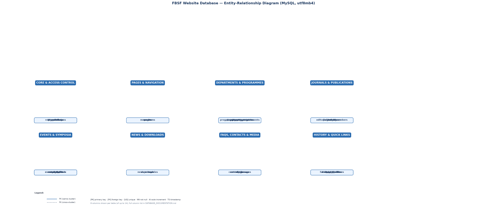

# FBSF Website Database — Documentation

> MySQL relational database for the redesigned **Faculty of Business Studies and Finance (FBSF)**, Wayamba University of Sri Lanka website.
> Generated from the reverse-engineering of the original static site and the redesigned HTML site; all seed data reflects the documented content in `migration/fbsf-content.json`.

**Schema version:** 1.0 · **Generated:** 2026-11-06 · **Engine:** InnoDB · **Charset:** utf8mb4 · **Tables:** 35

---

## 1. Overview

This database supports the dynamic content of the FBSF website. It is designed to be
integrated with a future backend (PHP, Node.js, or similar) that serves the existing
HTML/CSS/vanilla-JS frontend through API calls. The schema covers:

| Area | Tables | Purpose |
|---|---|---|
| Access control | `roles`, `permissions`, `role_permissions`, `users` | Role-based user accounts and staff logins |
| Pages & navigation | `pages`, `menus`, `menu_items` | CMS-managed pages and site menus (with dropdown parents) |
| Departments | `departments`, `department_partners` | The four FBSF departments and their industry partners |
| Programmes | `programme_categories`, `programmes`, `programme_entry_requirements`, `programme_courses` | Undergraduate programmes, entry requirements, course structure |
| Journals & publications | `journals`, `journal_issues`, `editorial_board_members`, `articles` | Academic journals, issues, editorial boards, article records |
| Events & symposia | `event_types`, `events`, `event_tracks`, `event_dates`, `event_committee`, `event_downloads` | Research symposia, tracks, deadlines, committees, materials |
| News & announcements | `news_categories`, `news` | Current news, announcements, and archived notices |
| Downloads | `downloads` | Guidelines, templates, proceedings, and student resources |
| FAQs & contacts | `faqs`, `contact_groups`, `contact_messages` | FAQ entries and the contact-form workflow |
| Media & assets | `media` | Uploaded images, documents, and other files |
| History & quick links | `history_timeline`, `quick_links`, `research_areas`, `faculty_committees` | Faculty history, external links, research areas, committees |
| Configuration | `site_settings` | Key-value site configuration (title, contact info, social links) |

### Design principles

- **Normalisation:** 3NF. Repeated values (categories, event types, contact groups) live in
  their own tables and are referenced by foreign keys. Long text is stored in `TEXT` columns;
  structured values are in `ENUM`/`VARCHAR`.
- **No static-content tables:** purely static layout code, CSS, and hand-written page sections
  are not stored in the database — only content that the website or its editors need to manage
  dynamically.
- **Explicit IDs:** every seed `INSERT` uses explicit primary keys so relations are unambiguous;
  parents are inserted before children (import order is safe).
- **Historical vs. current:** `deadline_status`, `status`, and `is_archived` flags distinguish
  concluded/past items from upcoming ones so the frontend can filter correctly.
- **Security:** passwords are stored only as bcrypt hashes; the single seeded admin uses a
  placeholder password and placeholder e-mail; no real credentials or secrets are included.
- **Unicode:** `utf8mb4` throughout (supports Sinhala, emoji, and all site characters).

---

## 2. Entity-Relationship Diagram



*`database_erd.png` — all 35 tables grouped into eight clusters, with primary keys, foreign keys, and unique keys marked. Dashed edges connect tables across clusters.*

---

## 3. Table catalog

### 3.1 Access control

#### `roles`

Staff roles assigned to users (admin, editor, author, viewer).

| Column | Type | Nullable | Key | Extra |
|---|---|---|---|---|
| `id` | `TINYINT` | NO | PRI | AUTO_INCREMENT |
| `name` | `VARCHAR(50)` | NO | UQ |  |
| `description` | `VARCHAR(255)` | YES |  |  |
| `created_at` | `DATETIME` | NO |  | DEFAULT CURRENT_TIMESTAMP |

**Primary key:** `id`

**Unique keys:** `uk_roles_name`, `name`

#### `permissions`

Granular permission keys (e.g. `manage_pages`, `publish_news`).

| Column | Type | Nullable | Key | Extra |
|---|---|---|---|---|
| `id` | `TINYINT` | NO | PRI | AUTO_INCREMENT |
| `permission_key` | `VARCHAR(100)` | NO | UQ |  |
| `description` | `VARCHAR(255)` | YES |  |  |
| `created_at` | `DATETIME` | NO |  | DEFAULT CURRENT_TIMESTAMP |

**Primary key:** `id`

**Unique keys:** `uk_permissions_key`, `permission_key`

#### `role_permissions`

Many-to-many mapping of roles to permissions.

| Column | Type | Nullable | Key | Extra |
|---|---|---|---|---|
| `role_id` | `TINYINT` | NO | PRI FK |  |
| `permission_id` | `TINYINT` | NO | PRI FK |  |
| `created_at` | `DATETIME` | NO |  | DEFAULT CURRENT_TIMESTAMP |

**Primary key:** `role_id`, `permission_id`

**Foreign keys:** `role_id` → `roles`(`id`), `permission_id` → `permissions`(`id`)

#### `users`

Backend staff accounts. Passwords are bcrypt hashes only.

| Column | Type | Nullable | Key | Extra |
|---|---|---|---|---|
| `id` | `INT` | NO | PRI | AUTO_INCREMENT |
| `username` | `VARCHAR(50)` | NO | UQ |  |
| `email` | `VARCHAR(190)` | NO | UQ |  |
| `password_hash` | `VARCHAR(255)` | NO |  |  |
| `full_name` | `VARCHAR(100)` | YES |  |  |
| `role_id` | `TINYINT` | NO | FK |  |
| `is_active` | `TINYINT(1)` | NO |  |  |
| `last_login_at` | `DATETIME` | YES |  |  |
| `created_at` | `DATETIME` | NO |  | DEFAULT CURRENT_TIMESTAMP |
| `updated_at` | `DATETIME` | NO |  | DEFAULT CURRENT_TIMESTAMP |

**Primary key:** `id`

**Unique keys:** `uk_users_username`, `username`, `uk_users_email`, `email`

**Foreign keys:** `role_id` → `roles`(`id`)

### 3.2 Pages & navigation

#### `pages`

CMS pages (about, departments, programmes, journals, events, news, contact, …).

| Column | Type | Nullable | Key | Extra |
|---|---|---|---|---|
| `id` | `INT` | NO | PRI | AUTO_INCREMENT |
| `slug` | `VARCHAR(190)` | NO | UQ |  |
| `title` | `VARCHAR(255)` | NO |  |  |
| `path` | `VARCHAR(255)` | NO |  |  |
| `template` | `VARCHAR(100)` | NO |  |  |
| `meta_title` | `VARCHAR(255)` | YES |  |  |
| `meta_description` | `VARCHAR(512)` | YES |  |  |
| `sort_order` | `INT` | NO |  |  |
| `is_published` | `TINYINT(1)` | NO |  |  |
| `created_at` | `DATETIME` | NO |  | DEFAULT CURRENT_TIMESTAMP |
| `updated_at` | `DATETIME` | NO |  | DEFAULT CURRENT_TIMESTAMP |

**Primary key:** `id`

**Unique keys:** `uk_pages_slug`, `slug`

#### `menus`

Site menus (main navigation, footer).

| Column | Type | Nullable | Key | Extra |
|---|---|---|---|---|
| `id` | `INT` | NO | PRI | AUTO_INCREMENT |
| `name` | `VARCHAR(100)` | NO | UQ |  |
| `location` | `VARCHAR(50)` | NO |  |  |
| `created_at` | `DATETIME` | NO |  | DEFAULT CURRENT_TIMESTAMP |

**Primary key:** `id`

**Unique keys:** `uk_menus_name`, `name`

#### `menu_items`

Menu links; `parent_id` self-reference creates dropdowns.

| Column | Type | Nullable | Key | Extra |
|---|---|---|---|---|
| `id` | `INT` | NO | PRI | AUTO_INCREMENT |
| `menu_id` | `INT` | NO | FK |  |
| `parent_id` | `INT` | YES | FK |  |
| `page_id` | `INT` | YES | FK |  |
| `title` | `VARCHAR(255)` | NO |  |  |
| `url` | `VARCHAR(512)` | NO |  |  |
| `target` | `VARCHAR(20)` | NO |  |  |
| `sort_order` | `INT` | NO |  |  |
| `is_published` | `TINYINT(1)` | NO |  |  |
| `created_at` | `DATETIME` | NO |  | DEFAULT CURRENT_TIMESTAMP |

**Primary key:** `id`

**Foreign keys:** `menu_id` → `menus`(`id`), `parent_id` → `menu_items`(`id`), `page_id` → `pages`(`id`)

### 3.3 Departments

#### `departments`

The four FBSF departments with contact and leadership details.

| Column | Type | Nullable | Key | Extra |
|---|---|---|---|---|
| `id` | `INT` | NO | PRI | AUTO_INCREMENT |
| `slug` | `VARCHAR(190)` | NO | UQ |  |
| `name` | `VARCHAR(255)` | NO |  |  |
| `abbreviation` | `VARCHAR(20)` | YES |  |  |
| `tagline` | `VARCHAR(255)` | YES |  |  |
| `intro` | `TEXT` | YES |  |  |
| `vision` | `TEXT` | YES |  |  |
| `mission` | `TEXT` | YES |  |  |
| `hod_name` | `VARCHAR(100)` | YES |  |  |
| `hod_title` | `VARCHAR(100)` | YES |  |  |
| `hod_message` | `TEXT` | YES |  |  |
| `research` | `TEXT` | YES |  |  |
| `contact_email` | `VARCHAR(190)` | YES |  |  |
| `contact_phone` | `VARCHAR(50)` | YES |  |  |
| `is_published` | `TINYINT(1)` | NO |  |  |
| `sort_order` | `INT` | NO |  |  |
| `created_at` | `DATETIME` | NO |  | DEFAULT CURRENT_TIMESTAMP |
| `updated_at` | `DATETIME` | NO |  | DEFAULT CURRENT_TIMESTAMP |

**Primary key:** `id`

**Unique keys:** `uk_departments_slug`, `slug`

#### `department_partners`

Industry partners listed for each department.

| Column | Type | Nullable | Key | Extra |
|---|---|---|---|---|
| `id` | `INT` | NO | PRI | AUTO_INCREMENT |
| `department_id` | `INT` | NO | FK |  |
| `partner_name` | `VARCHAR(255)` | NO |  |  |
| `detail` | `TEXT` | YES |  |  |
| `sort_order` | `INT` | NO |  |  |
| `created_at` | `DATETIME` | NO |  | DEFAULT CURRENT_TIMESTAMP |

**Primary key:** `id`

**Foreign keys:** `department_id` → `departments`(`id`)

### 3.4 Programmes

#### `programme_categories`

Groups of programmes (e.g. Degree, Diploma, Certificate).

| Column | Type | Nullable | Key | Extra |
|---|---|---|---|---|
| `id` | `TINYINT` | NO | PRI | AUTO_INCREMENT |
| `slug` | `VARCHAR(100)` | NO | UQ |  |
| `name` | `VARCHAR(100)` | NO |  |  |
| `sort_order` | `INT` | NO |  |  |

**Primary key:** `id`

**Unique keys:** `uk_programme_cat_slug`, `slug`

#### `programmes`

Undergraduate programmes offered by the faculty.

| Column | Type | Nullable | Key | Extra |
|---|---|---|---|---|
| `id` | `INT` | NO | PRI | AUTO_INCREMENT |
| `slug` | `VARCHAR(190)` | NO | UQ |  |
| `name` | `VARCHAR(255)` | NO |  |  |
| `category_id` | `TINYINT` | YES | FK |  |
| `department_id` | `INT` | YES | FK |  |
| `summary` | `TEXT` | YES |  |  |
| `description` | `TEXT` | YES |  |  |
| `duration` | `VARCHAR(100)` | YES |  |  |
| `credits` | `VARCHAR(50)` | YES |  |  |
| `fees` | `TEXT` | YES |  |  |
| `deadline` | `VARCHAR(100)` | YES |  |  |
| `deadline_status` | `ENUM('historical','upcoming','none')` | NO |  |  |
| `application_contact` | `TEXT` | YES |  |  |
| `entry_requirements` | `TEXT` | YES |  |  |
| `highlights` | `TEXT` | YES |  |  |
| `document_note` | `TEXT` | YES |  |  |
| `is_published` | `TINYINT(1)` | NO |  |  |
| `sort_order` | `INT` | NO |  |  |
| `created_at` | `DATETIME` | NO |  | DEFAULT CURRENT_TIMESTAMP |
| `updated_at` | `DATETIME` | NO |  | DEFAULT CURRENT_TIMESTAMP |

**Primary key:** `id`

**Unique keys:** `uk_programmes_slug`, `slug`

**Foreign keys:** `category_id` → `programme_categories`(`id`), `department_id` → `departments`(`id`)

#### `programme_entry_requirements`

Entry requirements per programme (ordered list).

| Column | Type | Nullable | Key | Extra |
|---|---|---|---|---|
| `id` | `INT` | NO | PRI | AUTO_INCREMENT |
| `programme_id` | `INT` | NO | FK |  |
| `requirement` | `TEXT` | NO |  |  |
| `sort_order` | `INT` | NO |  |  |
| `created_at` | `DATETIME` | NO |  | DEFAULT CURRENT_TIMESTAMP |

**Primary key:** `id`

**Foreign keys:** `programme_id` → `programmes`(`id`)

#### `programme_courses`

Course structure per programme (code, title, credits).

| Column | Type | Nullable | Key | Extra |
|---|---|---|---|---|
| `id` | `INT` | NO | PRI | AUTO_INCREMENT |
| `programme_id` | `INT` | NO | FK |  |
| `semester` | `VARCHAR(50)` | YES |  |  |
| `course_code` | `VARCHAR(50)` | YES |  |  |
| `course_title` | `VARCHAR(255)` | NO |  |  |
| `credits` | `VARCHAR(20)` | YES |  |  |
| `sort_order` | `INT` | NO |  |  |
| `created_at` | `DATETIME` | NO |  | DEFAULT CURRENT_TIMESTAMP |

**Primary key:** `id`

**Foreign keys:** `programme_id` → `programmes`(`id`)

### 3.5 Journals & publications

#### `journals`

Academic journals published by the faculty.

| Column | Type | Nullable | Key | Extra |
|---|---|---|---|---|
| `id` | `INT` | NO | PRI | AUTO_INCREMENT |
| `slug` | `VARCHAR(190)` | NO | UQ |  |
| `abbreviation` | `VARCHAR(50)` | YES |  |  |
| `name` | `VARCHAR(255)` | NO |  |  |
| `type` | `VARCHAR(100)` | YES |  |  |
| `publisher` | `VARCHAR(255)` | YES |  |  |
| `issn` | `VARCHAR(30)` | YES |  |  |
| `frequency` | `VARCHAR(100)` | YES |  |  |
| `description` | `TEXT` | YES |  |  |
| `submission_guidelines` | `TEXT` | YES |  |  |
| `submission_email` | `VARCHAR(190)` | YES |  |  |
| `latest_issue` | `VARCHAR(255)` | YES |  |  |
| `is_published` | `TINYINT(1)` | NO |  |  |
| `sort_order` | `INT` | NO |  |  |
| `created_at` | `DATETIME` | NO |  | DEFAULT CURRENT_TIMESTAMP |
| `updated_at` | `DATETIME` | NO |  | DEFAULT CURRENT_TIMESTAMP |

**Primary key:** `id`

**Unique keys:** `uk_journals_slug`, `slug`

#### `journal_issues`

Published issues per journal (year/volume).

| Column | Type | Nullable | Key | Extra |
|---|---|---|---|---|
| `id` | `INT` | NO | PRI | AUTO_INCREMENT |
| `journal_id` | `INT` | NO | FK |  |
| `year_volume` | `VARCHAR(100)` | YES |  |  |
| `detail` | `VARCHAR(255)` | YES |  |  |
| `sort_order` | `INT` | NO |  |  |
| `created_at` | `DATETIME` | NO |  | DEFAULT CURRENT_TIMESTAMP |

**Primary key:** `id`

**Foreign keys:** `journal_id` → `journals`(`id`)

#### `editorial_board_members`

Editorial board members per journal.

| Column | Type | Nullable | Key | Extra |
|---|---|---|---|---|
| `id` | `INT` | NO | PRI | AUTO_INCREMENT |
| `journal_id` | `INT` | NO | FK |  |
| `role` | `VARCHAR(100)` | NO |  |  |
| `name` | `VARCHAR(255)` | NO |  |  |
| `sort_order` | `INT` | NO |  |  |
| `created_at` | `DATETIME` | NO |  | DEFAULT CURRENT_TIMESTAMP |

**Primary key:** `id`

**Foreign keys:** `journal_id` → `journals`(`id`)

#### `articles`

Article records listed per journal.

| Column | Type | Nullable | Key | Extra |
|---|---|---|---|---|
| `id` | `INT` | NO | PRI | AUTO_INCREMENT |
| `journal_id` | `INT` | NO | FK |  |
| `title` | `VARCHAR(512)` | NO |  |  |
| `authors` | `TEXT` | YES |  |  |
| `issue` | `VARCHAR(255)` | YES |  |  |
| `description` | `TEXT` | YES |  |  |
| `created_at` | `DATETIME` | NO |  | DEFAULT CURRENT_TIMESTAMP |

**Primary key:** `id`

**Foreign keys:** `journal_id` → `journals`(`id`)

### 3.6 Events & symposia

#### `event_types`

Categories of events (symposium, workshop, seminar, conference).

| Column | Type | Nullable | Key | Extra |
|---|---|---|---|---|
| `id` | `TINYINT` | NO | PRI | AUTO_INCREMENT |
| `slug` | `VARCHAR(100)` | NO | UQ |  |
| `name` | `VARCHAR(100)` | NO |  |  |
| `sort_order` | `INT` | NO |  |  |

**Primary key:** `id`

**Unique keys:** `uk_event_types_slug`, `slug`

#### `events`

Research symposia and other events hosted by the faculty.

| Column | Type | Nullable | Key | Extra |
|---|---|---|---|---|
| `id` | `INT` | NO | PRI | AUTO_INCREMENT |
| `slug` | `VARCHAR(190)` | NO | UQ |  |
| `event_type_id` | `TINYINT` | NO | FK |  |
| `edition` | `VARCHAR(50)` | YES |  |  |
| `name` | `VARCHAR(255)` | NO |  |  |
| `organiser` | `VARCHAR(255)` | YES |  |  |
| `theme` | `VARCHAR(255)` | YES |  |  |
| `description` | `TEXT` | YES |  |  |
| `status` | `ENUM('past','upcoming','archived')` | NO |  |  |
| `submission_info` | `TEXT` | YES |  |  |
| `contact` | `TEXT` | YES |  |  |
| `keynote_name` | `VARCHAR(255)` | YES |  |  |
| `keynote_details` | `TEXT` | YES |  |  |
| `is_published` | `TINYINT(1)` | NO |  |  |
| `sort_order` | `INT` | NO |  |  |
| `created_at` | `DATETIME` | NO |  | DEFAULT CURRENT_TIMESTAMP |
| `updated_at` | `DATETIME` | NO |  | DEFAULT CURRENT_TIMESTAMP |

**Primary key:** `id`

**Unique keys:** `uk_events_slug`, `slug`

**Foreign keys:** `event_type_id` → `event_types`(`id`)

#### `event_tracks`

Research tracks / themes per event.

| Column | Type | Nullable | Key | Extra |
|---|---|---|---|---|
| `id` | `INT` | NO | PRI | AUTO_INCREMENT |
| `event_id` | `INT` | NO | FK |  |
| `title` | `VARCHAR(255)` | NO |  |  |
| `sort_order` | `INT` | NO |  |  |
| `created_at` | `DATETIME` | NO |  | DEFAULT CURRENT_TIMESTAMP |

**Primary key:** `id`

**Foreign keys:** `event_id` → `events`(`id`)

#### `event_dates`

Important dates (deadlines, notification, conference date) per event.

| Column | Type | Nullable | Key | Extra |
|---|---|---|---|---|
| `id` | `INT` | NO | PRI | AUTO_INCREMENT |
| `event_id` | `INT` | NO | FK |  |
| `label` | `VARCHAR(255)` | NO |  |  |
| `event_date` | `VARCHAR(100)` | YES |  |  |
| `sort_order` | `INT` | NO |  |  |
| `created_at` | `DATETIME` | NO |  | DEFAULT CURRENT_TIMESTAMP |

**Primary key:** `id`

**Foreign keys:** `event_id` → `events`(`id`)

#### `event_committee`

Organising committee members per event.

| Column | Type | Nullable | Key | Extra |
|---|---|---|---|---|
| `id` | `INT` | NO | PRI | AUTO_INCREMENT |
| `event_id` | `INT` | NO | FK |  |
| `role` | `VARCHAR(100)` | NO |  |  |
| `name` | `VARCHAR(255)` | NO |  |  |
| `contact` | `VARCHAR(190)` | YES |  |  |
| `sort_order` | `INT` | NO |  |  |
| `created_at` | `DATETIME` | NO |  | DEFAULT CURRENT_TIMESTAMP |

**Primary key:** `id`

**Foreign keys:** `event_id` → `events`(`id`)

#### `event_downloads`

Call-for-papers, templates, and related downloads per event.

| Column | Type | Nullable | Key | Extra |
|---|---|---|---|---|
| `id` | `INT` | NO | PRI | AUTO_INCREMENT |
| `event_id` | `INT` | NO | FK |  |
| `title` | `VARCHAR(255)` | NO |  |  |
| `note` | `VARCHAR(255)` | YES |  |  |
| `sort_order` | `INT` | NO |  |  |
| `created_at` | `DATETIME` | NO |  | DEFAULT CURRENT_TIMESTAMP |

**Primary key:** `id`

**Foreign keys:** `event_id` → `events`(`id`)

### 3.7 News & announcements

#### `news_categories`

Categories of news / announcements.

| Column | Type | Nullable | Key | Extra |
|---|---|---|---|---|
| `id` | `TINYINT` | NO | PRI | AUTO_INCREMENT |
| `slug` | `VARCHAR(100)` | NO | UQ |  |
| `name` | `VARCHAR(100)` | NO |  |  |
| `sort_order` | `INT` | NO |  |  |

**Primary key:** `id`

**Unique keys:** `uk_news_cat_slug`, `slug`

#### `news`

News items and announcements (current and archived).

| Column | Type | Nullable | Key | Extra |
|---|---|---|---|---|
| `id` | `INT` | NO | PRI | AUTO_INCREMENT |
| `slug` | `VARCHAR(190)` | NO | UQ |  |
| `news_type` | `ENUM('news','announcement')` | NO |  |  |
| `category_id` | `TINYINT` | YES | FK |  |
| `title` | `VARCHAR(255)` | NO |  |  |
| `body` | `TEXT` | NO |  |  |
| `status` | `ENUM('published','draft')` | NO |  |  |
| `is_archived` | `TINYINT(1)` | NO |  |  |
| `published_at` | `DATETIME` | YES |  |  |
| `sort_order` | `INT` | NO |  |  |
| `created_at` | `DATETIME` | NO |  | DEFAULT CURRENT_TIMESTAMP |
| `updated_at` | `DATETIME` | NO |  | DEFAULT CURRENT_TIMESTAMP |

**Primary key:** `id`

**Unique keys:** `uk_news_slug`, `slug`

**Foreign keys:** `category_id` → `news_categories`(`id`)

### 3.8 Downloads

#### `downloads`

Guidelines, templates, proceedings, and student resources.

| Column | Type | Nullable | Key | Extra |
|---|---|---|---|---|
| `id` | `INT` | NO | PRI | AUTO_INCREMENT |
| `slug` | `VARCHAR(190)` | NO | UQ |  |
| `name` | `VARCHAR(255)` | NO |  |  |
| `file_name` | `VARCHAR(255)` | YES |  |  |
| `category` | `VARCHAR(100)` | YES |  |  |
| `description` | `TEXT` | YES |  |  |
| `is_published` | `TINYINT(1)` | NO |  |  |
| `sort_order` | `INT` | NO |  |  |
| `created_at` | `DATETIME` | NO |  | DEFAULT CURRENT_TIMESTAMP |

**Primary key:** `id`

**Unique keys:** `uk_downloads_slug`, `slug`

### 3.9 FAQs & contacts

#### `faqs`

Frequently asked questions.

| Column | Type | Nullable | Key | Extra |
|---|---|---|---|---|
| `id` | `INT` | NO | PRI | AUTO_INCREMENT |
| `question` | `VARCHAR(255)` | NO |  |  |
| `answer` | `TEXT` | NO |  |  |
| `sort_order` | `INT` | NO |  |  |
| `is_published` | `TINYINT(1)` | NO |  |  |
| `created_at` | `DATETIME` | NO |  | DEFAULT CURRENT_TIMESTAMP |

**Primary key:** `id`

#### `contact_groups`

Contact categories (e.g. general office, academic, IT).

| Column | Type | Nullable | Key | Extra |
|---|---|---|---|---|
| `id` | `INT` | NO | PRI | AUTO_INCREMENT |
| `group_name` | `VARCHAR(100)` | NO |  |  |
| `contact_person` | `VARCHAR(255)` | YES |  |  |
| `email` | `VARCHAR(190)` | YES |  |  |
| `phone` | `VARCHAR(50)` | YES |  |  |
| `sort_order` | `INT` | NO |  |  |
| `created_at` | `DATETIME` | NO |  | DEFAULT CURRENT_TIMESTAMP |

**Primary key:** `id`

#### `contact_messages`

Messages submitted via the website contact form.

| Column | Type | Nullable | Key | Extra |
|---|---|---|---|---|
| `id` | `INT` | NO | PRI | AUTO_INCREMENT |
| `name` | `VARCHAR(100)` | NO |  |  |
| `email` | `VARCHAR(190)` | NO |  |  |
| `phone` | `VARCHAR(50)` | YES |  |  |
| `subject` | `VARCHAR(255)` | YES |  |  |
| `message` | `TEXT` | NO |  |  |
| `status` | `ENUM('new','read','replied','spam')` | NO |  |  |
| `user_id` | `INT` | YES | FK |  |
| `created_at` | `DATETIME` | NO |  | DEFAULT CURRENT_TIMESTAMP |
| `updated_at` | `DATETIME` | NO |  | DEFAULT CURRENT_TIMESTAMP |

**Primary key:** `id`

**Foreign keys:** `user_id` → `users`(`id`)

### 3.10 Media & assets

#### `media`

Uploaded files (images, documents, videos).

| Column | Type | Nullable | Key | Extra |
|---|---|---|---|---|
| `id` | `INT` | NO | PRI | AUTO_INCREMENT |
| `file_name` | `VARCHAR(255)` | NO |  |  |
| `file_path` | `VARCHAR(512)` | NO |  |  |
| `mime_type` | `VARCHAR(100)` | YES |  |  |
| `file_size` | `INT` | YES |  |  |
| `media_type` | `ENUM('image','document','video','other')` | NO |  |  |
| `alt_text` | `VARCHAR(512)` | YES |  |  |
| `uploaded_by` | `INT` | YES | FK |  |
| `created_at` | `DATETIME` | NO |  | DEFAULT CURRENT_TIMESTAMP |

**Primary key:** `id`

**Foreign keys:** `uploaded_by` → `users`(`id`)

### 3.11 History & quick links

#### `history_timeline`

Faculty history milestones.

| Column | Type | Nullable | Key | Extra |
|---|---|---|---|---|
| `id` | `INT` | NO | PRI | AUTO_INCREMENT |
| `event_date` | `VARCHAR(100)` | YES |  |  |
| `title` | `VARCHAR(255)` | NO |  |  |
| `description` | `TEXT` | YES |  |  |
| `sort_order` | `INT` | NO |  |  |

**Primary key:** `id`

#### `quick_links`

Quick links shown on the site.

| Column | Type | Nullable | Key | Extra |
|---|---|---|---|---|
| `id` | `INT` | NO | PRI | AUTO_INCREMENT |
| `title` | `VARCHAR(100)` | NO |  |  |
| `url` | `VARCHAR(512)` | NO |  |  |
| `icon` | `VARCHAR(50)` | YES |  |  |
| `description` | `VARCHAR(255)` | YES |  |  |
| `sort_order` | `INT` | NO |  |  |

**Primary key:** `id`

#### `research_areas`

Research areas of the faculty.

| Column | Type | Nullable | Key | Extra |
|---|---|---|---|---|
| `id` | `INT` | NO | PRI | AUTO_INCREMENT |
| `name` | `VARCHAR(100)` | NO |  |  |
| `sort_order` | `INT` | NO |  |  |

**Primary key:** `id`

#### `faculty_committees`

Faculty-level committees.

| Column | Type | Nullable | Key | Extra |
|---|---|---|---|---|
| `id` | `INT` | NO | PRI | AUTO_INCREMENT |
| `title` | `VARCHAR(255)` | NO |  |  |
| `description` | `TEXT` | YES |  |  |
| `sort_order` | `INT` | NO |  |  |

**Primary key:** `id`

### 3.12 Configuration

#### `site_settings`

Key-value site configuration.

| Column | Type | Nullable | Key | Extra |
|---|---|---|---|---|
| `id` | `INT` | NO | PRI | AUTO_INCREMENT |
| `setting_key` | `VARCHAR(100)` | NO | UQ |  |
| `setting_value` | `TEXT` | YES |  |  |
| `setting_group` | `VARCHAR(50)` | YES |  |  |
| `description` | `VARCHAR(255)` | YES |  |  |
| `updated_at` | `DATETIME` | NO |  | DEFAULT CURRENT_TIMESTAMP |

**Primary key:** `id`

**Unique keys:** `uk_settings_key`, `setting_key`

---

## 4. Foreign key relationships

| Child table | Column | Parent table | Parent column | On delete |
|---|---|---|---|---|
| `role_permissions` | `role_id` | `roles` | `id` | CASCADE |
| `role_permissions` | `permission_id` | `permissions` | `id` | CASCADE |
| `users` | `role_id` | `roles` | `id` | CASCADE |
| `menu_items` | `menu_id` | `menus` | `id` | CASCADE |
| `menu_items` | `parent_id` | `menu_items` | `id` | CASCADE |
| `menu_items` | `page_id` | `pages` | `id` | SET NULL |
| `department_partners` | `department_id` | `departments` | `id` | CASCADE |
| `programmes` | `category_id` | `programme_categories` | `id` | SET NULL |
| `programmes` | `department_id` | `departments` | `id` | CASCADE |
| `programme_entry_requirements` | `programme_id` | `programmes` | `id` | CASCADE |
| `programme_courses` | `programme_id` | `programmes` | `id` | CASCADE |
| `journal_issues` | `journal_id` | `journals` | `id` | CASCADE |
| `editorial_board_members` | `journal_id` | `journals` | `id` | CASCADE |
| `articles` | `journal_id` | `journals` | `id` | CASCADE |
| `events` | `event_type_id` | `event_types` | `id` | RESTRICT |
| `event_tracks` | `event_id` | `events` | `id` | CASCADE |
| `event_dates` | `event_id` | `events` | `id` | CASCADE |
| `event_committee` | `event_id` | `events` | `id` | CASCADE |
| `event_downloads` | `event_id` | `events` | `id` | CASCADE |
| `news` | `category_id` | `news_categories` | `id` | SET NULL |
| `contact_messages` | `user_id` | `users` | `id` | SET NULL |
| `media` | `uploaded_by` | `users` | `id` | SET NULL |

*Child rows are deleted when a parent is removed (`CASCADE`) for pure child content (tracks, dates, committee, downloads, issues, articles, requirements, courses, partners). Navigation and reference tables use `RESTRICT` to protect referenced pages/roles, and `SET NULL` for optional references.*

---

## 5. Sample queries

```sql
-- Published departments with their HODs
SELECT id, name, abbreviation, hod_name, hod_title, contact_email, contact_phone
FROM departments
WHERE is_published = 1
ORDER BY sort_order;

-- Programmes with category, department, and number of entry requirements
SELECT p.slug, p.name, pc.name AS category, d.name AS department,
       COUNT(per.id) AS requirement_count
FROM programmes p
LEFT JOIN programme_categories pc ON p.category_id = pc.id
LEFT JOIN departments d ON p.department_id = d.id
LEFT JOIN programme_entry_requirements per ON per.programme_id = p.id
WHERE p.is_published = 1
GROUP BY p.id
ORDER BY p.sort_order;

-- Upcoming events with their next deadline
SELECT e.slug, e.name, ed.label, ed.event_date
FROM events e
JOIN event_dates ed ON ed.event_id = e.id
WHERE e.status = 'upcoming' AND e.is_published = 1
ORDER BY ed.event_date;

-- Latest published news per category
SELECT n.title, n.published_at, nc.name AS category
FROM news n
JOIN news_categories nc ON n.category_id = nc.id
WHERE n.status = 'published' AND n.is_archived = 0
ORDER BY n.published_at DESC;

-- Journal issues with article counts
SELECT j.abbreviation, j.name, ji.year_volume,
       COUNT(a.id) AS article_count
FROM journals j
JOIN journal_issues ji ON ji.journal_id = j.id
LEFT JOIN articles a ON a.journal_id = j.id
WHERE j.is_published = 1
GROUP BY j.id, ji.id
ORDER BY j.sort_order, ji.sort_order;

-- Contact messages awaiting a reply
SELECT id, name, email, subject, created_at
FROM contact_messages
WHERE status = 'new'
ORDER BY created_at;

-- Menu items for the main navigation (with dropdown parents)
SELECT mi.id, mi.title, mi.url, mi.target, p.title AS parent_title
FROM menu_items mi
LEFT JOIN menu_items p ON mi.parent_id = p.id
WHERE mi.is_published = 1
ORDER BY mi.sort_order;

-- Password check (never store plain text)
SELECT id, username, email
FROM users
WHERE email = 'admin@example.com'
  AND password_hash = '$2b$12$HGUOf.7dl0q9AXV.f6z3BepAeihUJX/weIslDeBTyOghajoWv3pU2';
```

---

## 6. Importing into MySQL

### 6.1 Requirements

- MySQL 8.0+ (uses `utf8mb4_unicode_ci`, `JSON`-free design, InnoDB).
- A database user with `CREATE` and `INSERT` privileges.

### 6.2 phpMyAdmin

1. Open **phpMyAdmin** for the target server.
2. Create a new database, e.g. `bsf_website` (charset **utf8mb4**, collation **utf8mb4_unicode_ci**).
3. Select the new database and click **Import** (or the SQL tab → **Import**).
4. Choose `database/website_database.sql` and click **Go**.
5. Verify: the file creates the schema and loads all seed rows in one pass — no further steps needed.
6. Check the **Structure** tab: 35 tables should be listed. Open a few (`programmes`, `journals`, `events`) to confirm seed rows are present.

### 6.3 MySQL CLI

```bash
mysql -u <user> -p < bsf_website < database/website_database.sql
```

The script begins with `CREATE DATABASE IF NOT EXISTS` + `USE`, so it can also run standalone:

```bash
mysql -u <user> -p < database/website_database.sql
```

### 6.4 Post-import checks

```sql
SHOW TABLES;                    -- expect 35 tables
SELECT COUNT(*) FROM users;     -- expect 1 (placeholder admin)
SELECT COUNT(*) FROM pages;     -- expect 14
SELECT COUNT(*) FROM news;      -- expect 10
SELECT COUNT(*) FROM faqs;      -- expect 8
```

---

## 7. Backend integration

The frontend (HTML/CSS/vanilla JS) must **not** contain database credentials or direct
database-connection code. A future backend (PHP/Node.js) exposes API endpoints that query
this database. Recommended approach:

```
Frontend (vanilla JS fetch)  →  Backend API (/api/…)  →  MySQL database
```

Example endpoints:

| Endpoint | Query |
|---|---|
| `GET /api/departments` | Section 5 query #1 |
| `GET /api/programmes` | Section 5 query #2 |
| `GET /api/events/upcoming` | Section 5 query #3 |
| `GET /api/news` | Section 5 query #4 |
| `GET /api/journals` | Section 5 query #5 |
| `POST /api/contact` | Insert into `contact_messages` |
| `POST /api/login` | Verify bcrypt hash in `users` |

Connection details belong in server-side environment configuration, never in client code.

---

## 8. Security notes

- The seeded admin account `admin@example.com` uses the bcrypt hash of the placeholder
  password `change-me-on-first-login`. **Change the password immediately after first login.**
- Do not commit real database credentials, API keys, or secrets. Store them in environment
  variables on the server.
- Use least-privilege database accounts: the web application should use a user with only the
  permissions it needs (SELECT/INSERT/UPDATE on content tables; not `DROP`/`CREATE`).
- Validate and parameterise all queries on the backend to prevent SQL injection.
- Contact messages are user-submitted content: sanitise before display (HTML-escape).

---

## 9. Seed data summary

| Table | Seed rows |
|---|---|
| `roles` | 4 |
| `permissions` | 10 |
| `role_permissions` | 22 |
| `users` | 1 |
| `pages` | 14 |
| `menus` | 2 |
| `menu_items` | 25 |
| `departments` | 4 |
| `department_partners` | 14 |
| `programme_categories` | 6 |
| `programmes` | 10 |
| `programme_entry_requirements` | 25 |
| `programme_courses` | 21 |
| `journals` | 7 |
| `journal_issues` | 29 |
| `editorial_board_members` | 6 |
| `articles` | 24 |
| `event_types` | 4 |
| `events` | 3 |
| `event_tracks` | 37 |
| `event_dates` | 13 |
| `event_committee` | 10 |
| `event_downloads` | 8 |
| `news_categories` | 4 |
| `news` | 10 |
| `downloads` | 7 |
| `faqs` | 8 |
| `contact_groups` | 6 |
| `contact_messages` | 1 |
| `media` | 4 |
| `history_timeline` | 5 |
| `quick_links` | 6 |
| `research_areas` | 9 |
| `faculty_committees` | 4 |
| `site_settings` | 16 |

*All seed data is derived from the verified site content in `migration/fbsf-content.json`;
items not present in the source (e.g. journal submission e-mails) are stored as `NULL` and
marked "Information not available" rather than invented.*

